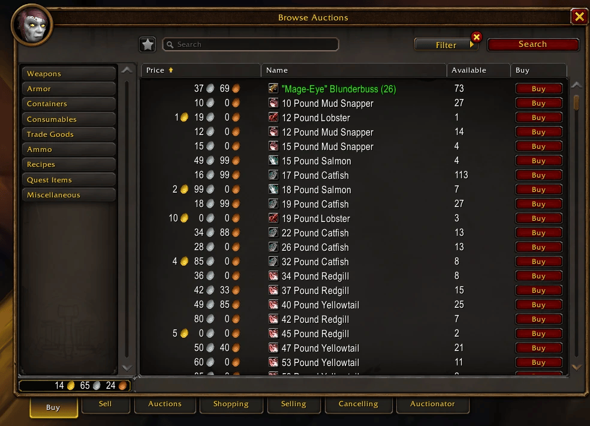

# Going Once

A Buyout button on every row of the auction house list, for World of Warcraft: Forever.

Buying from Blizzard's auction house means clicking an item, waiting for its auctions, picking one, then Buyout
and a confirmation. Going Once adds a **Buy** column at the right of the browse list: hover a row, click its Buy
button, and the cheapest one is yours.



- **Gear and other single items:** hovering a row reads its auctions, and one click buys the cheapest at its
  buyout price. It asks for a second click when the cheapest now costs more than the list shows, or costs at
  least an amount you choose (50 gold to start with).
- **Trade goods:** the button says `Buy`, or `Buy 20` for a stack. A click asks the auction house for the price.
  If every unit costs what the list shows, that click buys; if they cost more, the button shows the total and
  the next click buys. Right-click or Shift-click the button to choose how many to buy, remembered for each item.
- **The tooltip** says what a click will do. The button is greyed out when you can't afford it, when only your
  own auctions are left, or when the auctions only take bids.
- **A chat line** after each purchase names the item and what you paid. If the auction house refuses a purchase,
  the chat says so.

Every purchase needs a click: that is Blizzard's rule. The one thing Going Once does without a click is accept
a trade good's price you clicked for, when it matches the list.

## Install

Install it from [CurseForge](https://www.curseforge.com/wow/addons/going-once), by hand or with an addon manager,
or extract the zip from the newest [release](https://github.com/Rambomst/going-once/releases) into
`World of Warcraft/_forever_/Interface/AddOns`.

## Settings

In Options, AddOns, Going Once, or type `/goingonce`:

- **Buy trade goods on one click** (on): when the price matches the list, the first click buys.
- **Second click for gear from** (50 gold): gear at this price or more needs a second click. Type any amount in
  gold, silver and copper; leave it at 0 to never ask. Gear that costs more than the list shows always asks.
- **Chat line after buying** (on): the item and what you paid.
- **Saved trade good amounts:** Forget puts every trade good back to buying one at a time.

## "Internal auction error"

Forever's auction house sometimes flashes "Internal auction error" in red for a purchase that goes through a
moment later. Going Once waits for the purchase's own answer, so the chat line says it was bought (and that the
message did not stop it). If no answer comes, the chat says to check your mail before buying again.

## Bugs and ideas

Report them as an [issue](https://github.com/Rambomst/going-once/issues). For a purchase that went wrong, type
`/reload` after it and attach the `log` part of `WTF/Account/<account>/SavedVariables/GoingOnce.lua`: it lists the
last 200 steps, from what was searched to every answer and error the auction house sent.

## Support

If Going Once saves you some clicks and you'd like to say thanks, you can
[buy me a coffee on Ko-fi](https://ko-fi.com/ram01). It's free either way.

## Development

Everything the addon runs is in `GoingOnce.lua`, plus the settings row template in `GoingOnce.xml`:

- **Offers** (`Send`, `ReadItem`, `ReadCommodity`): reading a row's auctions, and what a read found.
- **Hover**: reads start when the mouse is on a row.
- **Purchases** (`BuyItem`, `BuyCommodity`, `Confirm`, `GiveUp`): the one purchase in flight, from the click to
  the auction house's answer.
- **Slots**: a row's button in the Buy column, its label and tooltip (`Slot:State`).
- **Settings**: the panel, `GoingOnceMoneyControlMixin` (the gold, silver and copper row) and
  `GoingOnceButtonControlMixin` (the Forget button, lined up with the other controls).

The auction house rules it is built on:

- A browse row has no auction ID, and the server only takes a bid on an auction from the last item search sent.
  So hovering a row searches that item, and a click on an older read only reads again.
- `PlaceBid` and `StartCommoditiesPurchase` need a click (a hardware event); `ConfirmCommoditiesPurchase` does
  not, which is how a trade good buys on one click.
- A search sent while a trade good's price quote is open spoils the quote ("Internal auction error"), so no read
  goes out while a purchase is in flight.
- An error from the auction house names no request, and the server sometimes answers a good purchase with one.
  So a purchase ends on its own answer (`AUCTION_HOUSE_PURCHASE_COMPLETED`, the "You won an auction"
  notification, or the commodity events), and on an error only when only a bid could have caused it.
- Every item search makes the server refresh the browse list, and Blizzard scrolls it to the top; Going Once
  puts the scroll position back.
- Nothing is written into Blizzard's tables. Blizzard sizes the browse table to the list's scroll box, so Going
  Once makes the scroll box a column narrower and Blizzard lays out the narrower table itself; the Buy column fills
  the space. Rows are followed with `hooksecurefunc` hooks on the list's table builder (`ArrangeCells`,
  `RemoveRow`), so Blizzard's own buying keeps running untainted.

Lua is formatted with [StyLua](https://github.com/JohnnyMorganz/StyLua): run `stylua .`, which reads `.stylua.toml`.

### Tests

The tests run the addon on forever_sim, the headless Forever client from
[forever-core](https://github.com/cjber/forever-core), with Blizzard's real auction house and settings code and a
stand-in for the auction house server (`tests/fake_ah.lua`). They need LuaJIT, Python 3 and git:

```bash
tests/run.sh
```

The first run downloads forever_sim at the commit pinned in `tests/forever_sim.txt`, and the Blizzard UI source and
client data it runs against, into `~/.cache/goingonce-sim`.

- `tests/run.sh "trade good"` runs only the scenarios whose names contain that text.
- `FOREVER_SIM` points the tests at another forever_sim folder, such as the one in a forever-core checkout
  (`.agents/skills/wow-forever-addon/tooling/forever_sim`).
- `GOINGONCE_BASELINE=1` runs a scenario on Blizzard's UI alone, to tell a gap in the sim from a fault in the
  addon. `GOINGONCE_ADDON_DIR` runs the scenarios against another copy of the addon, such as an installed one.

CI runs the tests on every push and pull request.

### In game

Copy or link this repository into `Interface/AddOns` as `GoingOnce` (the folder name has to match the TOC's), then
restart the game, which only looks for new addon folders at startup. After that, `/reload` loads your changes.

## License

MIT
